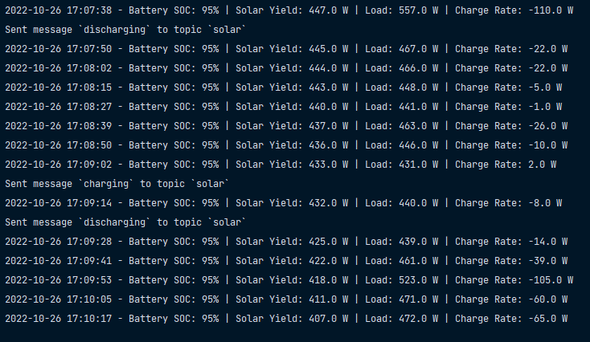

# TBB-Inverter-Data-Scraper
Collect TBB inverter data by means of Python request scraping.
# Example Output


# Deployment
Runs as a Docker Compose service. Settings come from a `.env` file next to `docker-compose.yml`
(`TBB_USERNAME`, `TBB_PASSWORD`, `TBB_SITE_ID`, `MQTT_BROKER`, `MQTT_PORT`, `MQTT_TOPIC`, `MQTT_USERNAME`, `MQTT_PASSWORD`).

```sh
git pull
docker compose up -d --build
```

Deploys are manual for now: the previous GitHub Actions workflow logged in over SSH with a password
through a port forward that no longer exists, so it was removed.

The scraper restarts itself after a crash or reboot (`restart: unless-stopped`), and every request to TBB
times out after 30 seconds so a stalled connection is retried instead of hanging.

# Home Assistant
Entities are announced through MQTT discovery. The discovery messages are retained and are also
republished whenever the scraper (re)connects to the broker or Home Assistant reports `online`
on `homeassistant/status`, so the entities survive a Home Assistant or broker restart.

# Raw capture
`capture.py` is an optional second service that records everything TBB reports about the site,
unprocessed, so the status codes and alarms can be studied across different states (grid outage,
low battery, charging, normal). It does not change what the scraper publishes.

```sh
docker compose --profile capture up -d --build tbb-capture   # start
docker compose --profile capture stop tbb-capture            # stop
```

Output goes to `capture-data/YYYY-MM-DD.jsonl`, one JSON record per line with a local timestamp,
a source and the raw data. Records are written when something changes and at a fixed interval:

| Source | What | Written |
|---|---|---|
| `rest` | The site record the scraper reads (`alarm_status`, `running_type`, `battery_status`, ...) | on a state change, and every 60 s |
| `events` | The active alarm/fault list from Nova's live feed, with names | on change, and every 5 min |
| `realdata` | 60 live readings from the live feed as `{address: [value, unit]}` | when a state/flag value changes, and every 30 s |
| `tree` | The equipment list sent at login | on connect |
| `ws` | Any other live-feed message | always |
| `note` | Markers you type | when typed |

To mark a manual test ("grid breaker off", "back to normal"), type into the **TBB capture note**
text entity that the capture announces in Home Assistant. The note is stored with its timestamp.

Known values, from TBB's web app: `alarm_status` 0 = normal, 1 = fault, 2 = warning (only shown when
`alarm_remind` is 1); `running_type` 0 = inverter, 1 = solar, 2 = battery, 3 = grid, 4 = generator.

`nova_live.py` is the client for the live feed (a websocket with encrypted payloads). It can only
send the login and the read request for live readings; the control commands that the same
connection accepts are not implemented on purpose. `nova_addresses.json` lists the readings to
request. The list and names come from the web app's code for a Kinergy I / Apollo Maxx system;
the names are the app's internal ones and a few are misleading (for example `batteryPower` is a voltage).
